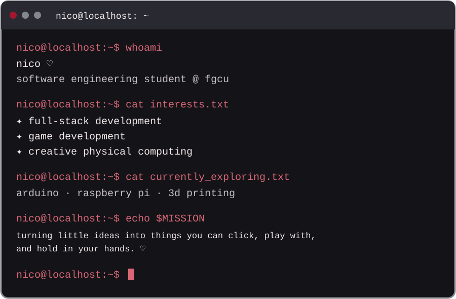
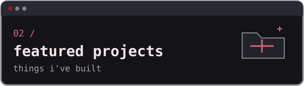
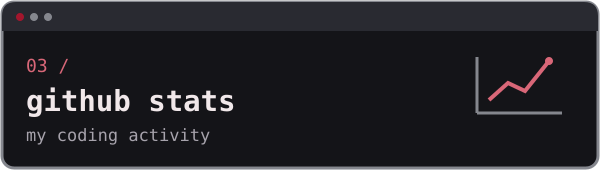

<!-- this is the banner + terminal -->

<div align="center">

  



</div>

<!-- this is the 4 little squares -->

<table align="center">
  <tr>
    <td width="50%" align="center">
      <a href="#languages--tools">
        
      </a>
    </td>
    <td width="50%" align="center">
      <a href="#featured-projects">
        
      </a>
    </td>
  </tr>
  <tr>
    <td width="50%" align="center">
      <a href="#github-stats">
        
      </a>
    </td>
    <td width="50%" align="center">
      <a href="#little-garden">
        
      </a>
    </td>
  </tr>
</table>

----------------------------------------------------------------------------------

## languages & tools

<sub>01 / my dev tools</sub>

### programming languages

<sub><code>nico@dev:~$ ls ./languages</code></sub>

<code>python</code> <code>c++</code> <code>c</code> <code>java</code> <code>javascript</code> <code>typescript</code> <code>HTML</code> <code>CSS</code> <code>SQL</code>

### frameworks & web development

<sub><code>nico@dev:~$ ls ./frameworks</code></sub>

<code>react</code> <code>next.js</code> <code>node.js</code> <code>tailwind CSS</code> <code>supabase</code> <code>REST APIs</code> 

### databases

<sub><code>nico@dev:~$ ls ./databases</code></sub>

<code>postgreSQL</code> <code>supabase database</code>

### developer tools

<sub><code>nico@dev:~$ ls ./tools</code></sub>

<code>git</code> <code>gitHub</code> <code>github CLI</code> <code>VS Code</code> <code>visual studio</code> <code>pyCharm</code> <code>CLion</code> <code>WSL2 / Ubuntu</code> <code>CMake</code> <code>MinGW / GCC</code> <code>VirtualBox</code> <code>arduino</code>

### currently exploring

<sub><code>nico@dev:~$ ls ./learning</code></sub>

<code>raspberry pi</code> <code>3D printing</code> <code>IntelliJ IDEA</code> <code>docker</code> <code>MySQL</code> <code>SQLite</code> 

--------------------------------------------------------------------------------------------------------------------------------------------

## featured projects

<code>nico@dev:~$ tree ~/projects</code>


```text
nico/
└── projects/
    ├── 🎬 reel-talk/
    │   ├── movie & tv journaling application
    │   └── status: in development
    │
    └── 🌱 algosprout/
        ├── interactive algorithm learning platform
        └── status: in development
```

<details>
  <summary>📂 reel-talk/ — open folder</summary>

  <h3>reel talk</h3>

  <p>
    a movie and TV journaling application where users
    can track what they watch, write reviews, rate titles,
    and organize entries into personal or collaborative journals. 
  </p>

  <p><b>status:</b> 🚧 in development</p>

  <p><b>built with:</b></p>

  <p>
    <code>Next.js</code>
    <code>TypeScript</code>
    <code>Tailwind CSS</code>
    <code>Supabase</code>
    <code>TMDB API</code>
  </p>

</details>

<br>

<details>
  <summary>📂 algosprout/ — open folder</summary>

  <h3>algosprout</h3>

  <p>grow your understanding in dsa!!</p>

  <p>
    an interactive algorithm learning platform
    featuring visualizations, step-by-step explanations,
    educational games, and personalized learning progress.
  </p>

  <p><b>status:</b> 🚧 in development</p>

  <p><b>focus:</b></p>

  <p>
    <code>algorithms</code>
    <code>data structures</code>
    <code>interactive learning</code>
    <code>gamification</code>
  </p>

</details>

-----------------------------------------------------------------

## github stats
-----------------------------------------------------------------
## little garden
