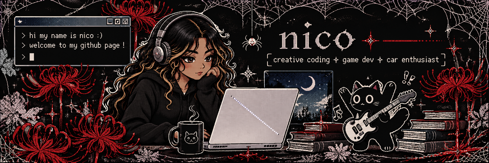
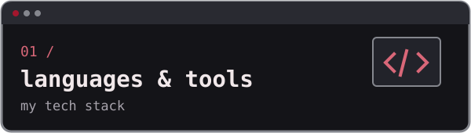
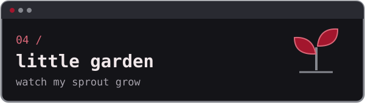

<!-- this is the banner + terminal -->

  

<!-- this is the 4 little squares -->

<table align="center">
  <tr>
    <td width="50%" align="center">
      
    </td>
    <td width="50%" align="center">
      
    </td>
  </tr>
  <tr>
    <td width="50%" align="center">
      
    </td>
    <td width="50%" align="center">
      
    </td>
  </tr>
</table>

-------------------------------------------------

# hi my name is nico :)

### welcome to my github page 

💻 creative coding ⌘ game dev ⌘ car enthusiast

-------------------------------------------------

## about me

## languages & tools

01 / my dev tools

### programming languages

python · c++ · c · javaScript · typeScript · HTML · CSS · SQL

### frameworks & web development

react · next.js · node.js · tailwind CSS · supabase · REST APIs 

### databases

postgreSQL · supabase database

### developer tools

git · gitHub · gitHub CLI · VS Code · visual studio · PyCharm · CLion · WSL2 / Ubuntu · CMake · MinGW / GCC · VirtualBox · arduino

### currently exploring

raspberry pi · 3D printing · DBeaver · IntelliJ IDEA · docker · MySQL · SQLite 

## featured projects

## github stats

## little garden
